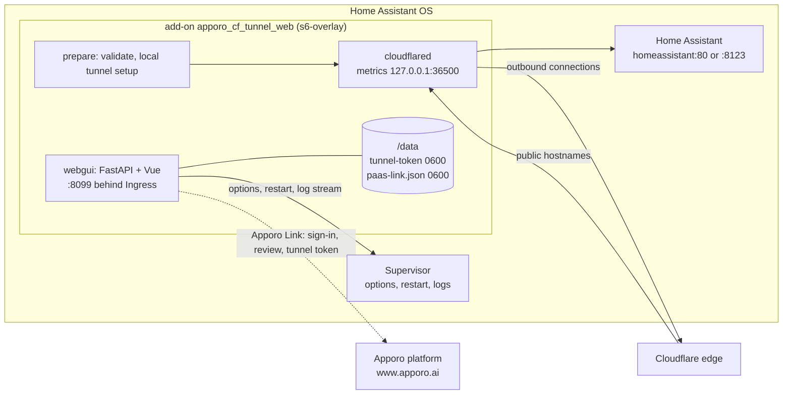

<p align="center">
  
</p>

<h1 align="center">Apporo CF Tunnel Web for Home Assistant</h1>

<p align="center">
  <strong>Connect an Apporo Security Access (Cloudflare Tunnel) to Home Assistant without opening ports, with a Web GUI.</strong>
</p>

<p align="center">
  <a href="README_zh-TW.md">繁體中文</a> &bull;
  <a href="#install">Install</a> &bull;
  <a href="#connect-an-apporo-security-access">Connect</a> &bull;
  <a href="#home-assistant-behind-the-tunnel">Reverse proxy</a> &bull;
  <a href="#differences-from-upstream">Differences</a> &bull;
  <a href="#development">Development</a>
</p>

<p align="center">
  
  
  
  
  
</p>

---

## Overview

Apporo CF Tunnel Web is the Apporo edition of
[Woow Cloudflared](https://github.com/WOOWTECH/Woow_ha_cf_tunnel_webgui), WOOWTECH's
Cloudflared add-on with a Web GUI, forked from its version 1.1.3. It can do everything
upstream can. The difference is where the platform link goes: the **Apporo Link** page
connects Home Assistant to a **Security Access** on the Apporo platform
([www.apporo.ai](https://www.apporo.ai)), not to WOOW PaaS.

A Security Access is the Apporo platform's tunnel service. The platform creates the
Cloudflare tunnel and its public hostnames (routes), and can put a Cloudflare Access sign-in
in front of each route. This add-on runs the connector, `cloudflared`, inside Home Assistant,
so nothing has to be opened on your router.

It also works without Apporo, as upstream does: paste any Cloudflare tunnel token, or let the
add-on create a tunnel in your own Cloudflare account. The tunnel core and its options come
from [homeassistant-apps/app-cloudflared][upstream-core], with WOOW's hardening on top.

- On a Linux host without Home Assistant OS, use the Podman edition,
  [Apporo CF Tunnel Web](https://github.com/WOOWTECH/Apporo_podman_cf_tunnel_webgui).
- [Apporo Home Connect](https://github.com/WOOWTECH/apporo_ha_home_connect), the Home
  Assistant integration for Apporo remote access (optionally with MCP), does not run Security
  Access. This add-on does.

### Web GUI

The Web GUI is served through Home Assistant Ingress: use the add-on's **Open Web UI** button
or **Apporo Tunnel** in the sidebar. No extra port is opened, and your Home Assistant login
protects it.

| Page | What it does |
|---|---|
| **Dashboard** | Live tunnel status (edge connections), add-on state, restart |
| **Apporo Link** | Device sign-in at www.apporo.ai, workspace and Security Access choice, a review of every route, connect, checks of the public hostnames, disconnect |
| **Setup** | A tunnel in your own Cloudflare account (local-managed): the Cloudflare authorization URL appears as a link instead of in the log |
| **Config** | Every add-on option, saved through the Supervisor, so this page and the add-on's Configuration tab always agree |
| **Logs** | The live add-on log (the same as the Log tab), with filter and download |

With an empty configuration, the add-on keeps the Web GUI running with the tunnel stopped, so
the first setup can happen in the browser. Upstream app-cloudflared exits in that case.

## Requirements

- Home Assistant OS (or another installation with the Supervisor) on amd64 or aarch64.
- For the Apporo Link: an Apporo account that is an owner or admin of the workspace holding
  the Security Access.
- Without Apporo: a Cloudflare tunnel token, or a Cloudflare account with a domain for a
  local-managed tunnel.

## Install

1. In Home Assistant, open **Settings > Apps > App store** (**Settings > Add-ons > Add-on
   store** in older releases). Open the **⋮** menu at the top right, choose **Repositories**,
   add `https://github.com/WOOWTECH/Apporo_ha_cf_tunnel_webgui` and close the dialog.

   Or use this button:

   [](https://my.home-assistant.io/redirect/supervisor_add_addon_repository/?repository_url=https%3A%2F%2Fgithub.com%2FWOOWTECH%2FApporo_ha_cf_tunnel_webgui)

2. Select **Apporo CF Tunnel Web** (listed under the repository "Apporo CF Tunnel Web
   (Apporo)") and choose **Install**. If it does not show up, choose **Check for updates** in
   the **⋮** menu and reload the page.
3. Choose **Start**. Without a configuration only the Web GUI runs; the tunnel stays stopped
   until you connect it.
4. Choose **Open Web UI**, or open **Apporo Tunnel** in the sidebar.

Then connect an Apporo Security Access (next section), or use the Setup page for your own
Cloudflare account.

## Connect an Apporo Security Access

First create the Security Access on [www.apporo.ai](https://www.apporo.ai): a workspace, a
plan and at least one route. A route is a public hostname and the internal service URL it
leads to; for Home Assistant itself, see [Route targets](#route-targets). Plans, trials and
payment are all handled on the portal. The add-on never charges anything.

There are two ways to connect.

### Option 1: the Apporo Link page (recommended)

1. **Sign in.** Open **Apporo Link** and choose **Get device code**. Open the device page it
   links to (`https://www.apporo.ai/device`), sign in to your Apporo account, enter the code
   and allow the connection. The code is valid for up to 15 minutes, and the page updates by
   itself. This page never asks for a tunnel token.
2. **Pick the Security Access.** Choose the workspace, then the Security Access service. If
   the workspace has none yet, the page links to the portal so you can create one; then choose
   **I've finished on Apporo, reload services**.
3. **Review the routes.** The page checks the service and every route before you can
   connect:
   - the service is active, its subscription is valid and its tunnel exists;
   - it is not bound to another device and has no second connector;
   - every route has a public hostname and an internal service URL;
   - a route **with** Access needs a plan with Access seats, a login method (Email OTP or
     Google), and an allow rule that names specific emails or an email domain. Broad rules
     (everyone, IP ranges, countries, bypass) are refused;
   - a route **without** Access (public) works without seats. But anyone who knows the
     hostname reaches your service, so the service's own login must be on (Home Assistant
     has one). The page lists these routes and asks you to confirm before it connects.

   Fix what the page reports on the portal (the Security Access's **Application** tab for
   routes, its **Access** tab for protection), then choose **Check again**.
4. **Connect.** Choose **Connect and enable**. The page checks once more. It then fetches the
   tunnel credential, binds this add-on on the platform as `Apporo CF Tunnel Web (HA add-on)`,
   saves the token in the add-on's `tunnel_token` option and restarts the add-on. The Web GUI
   is unavailable for a few seconds while it restarts. If the token cannot be saved, the
   previous options are restored and the binding is released.

After you connect, **Refresh connection status** shows the subscription, the access mode of
each hostname and the tunnel. **Test public URLs** sends an anonymous request to each public
hostname. It shows whether a hostname answers with the Access sign-in, a public response, a
block or an origin error. It does not prove that a given person can sign in. After you change
a route's protection, the platform publishes the change only once a connector is online. Until
then the hostname answers 503, and the page shows the route as waiting to be published.

While the link is active, the token on the Config page is locked. **Stop the local connection
and release the binding** removes the token and the local route options (`external_hostname`,
`additional_hosts`, `catch_all_service`, `nginx_proxy_manager`) and restarts the add-on. When
the old connector has stopped, the binding is released on the platform: automatically when the
add-on starts again, or with **Check and finish the remote release**. Note any local-mode
settings you want to keep before you disconnect. Disconnecting does not delete hostnames, DNS
records, Access settings or the subscription. Do that on the portal.

You can revoke the account authorization on the same page when nothing is connected.

### Option 2: paste the tunnel token

1. On [www.apporo.ai](https://www.apporo.ai), open your workspace, then the Security Access.
   On its **Overview** tab, find **Connect a machine** > **Tunnel token**, and reveal or copy
   the token. Treat it like a password.
2. Paste it in either place:
   - the Web GUI's **Config** page: paste the token (a whole `cloudflared service install …`
     command also works) into the tunnel token field, then choose **Save & Restart**;
   - the add-on's **Configuration** tab in Home Assistant: set the `tunnel_token` option
     (turn on **Show unused optional configuration options** if it is hidden), save, then
     restart the add-on.

With a token, the routes come from the platform. Manage them on the portal's Application tab;
the local hostname and route options are ignored. While a pasted token is set, the Apporo
Link page refuses to connect; remove the token on the Config page first if you want to switch.

Run a token in one place at a time. When two connectors run the same token, Cloudflare may
send visitors to either of them. Stop the old connector as soon as the new one is up.

### Route targets

`cloudflared` runs inside the add-on, on Home Assistant's internal network, so the internal
service URL of a route names Home Assistant as `homeassistant`:

- Home Assistant: `http://homeassistant:<port>`, with the **Server port** shown under
  **Settings > System > Network > HTTP server**. That is usually 80 on recent installations
  (the default under the Supervisor since Home Assistant 2026.8) and 8123 on older ones.
- another add-on: its hostname, shown on the add-on's Info page, with its port.
- a device on your network: its address, for example `http://192.168.1.2:5001`.

A 502 usually means a wrong address or port, or a service that is not running. A 400 from
Home Assistant means that it does not trust the proxy yet (next section).

## Home Assistant behind the tunnel

Home Assistant refuses requests that reach it through a proxy it does not trust, and answers
400 Bad Request. Requests from this add-on come from the Supervisor's internal network, so
trust that network once:

- In **Settings > System > Network > HTTP server**, under **Reverse proxy**, turn on **Trust
  X-Forwarded-For** and add `172.30.33.0/24` to **Trusted proxies**. Save and restart Home
  Assistant, then confirm the new HTTP server settings when Home Assistant asks. Since
  Home Assistant 2026.8 this page is the place for these settings: an `http:` block in
  `configuration.yaml` is imported once and ignored after that.
- In releases before 2026.8, which have no such page, add this to `configuration.yaml`
  instead and restart Home Assistant:

  ```yaml
  http:
    use_x_forwarded_for: true
    trusted_proxies:
      - 172.30.33.0/24
  ```

`172.30.33.0/24` is the network that add-ons get their addresses from, as upstream documents
it. On a non-standard installation (Proxmox, for example), check the Home Assistant log after
a failed request for the address to trust.

## Your own Cloudflare account

As upstream:

- **Remote-managed tunnel:** create a tunnel in the Cloudflare Zero Trust dashboard and paste
  its token on the Config page or into the `tunnel_token` option. Manage its routes in the
  Cloudflare dashboard.
- **Local-managed tunnel:** set `external_hostname` and/or `additional_hosts` and start the
  add-on. It creates the tunnel and the DNS records in your Cloudflare account. The Setup page
  shows the Cloudflare authorization link.

Every option is described in the [add-on documentation](cloudflared/DOCS.md), which Home
Assistant also shows on the add-on's Documentation tab.

## Next to WOOW's Cloudflared add-on

This add-on has its own slug (`apporo_cf_tunnel_web`) and image, so Home Assistant treats it as
a separate add-on. It installs next to WOOW's Cloudflared add-on (slug `cloudflared`) instead
of upgrading it, and starts with empty options and data of its own: nothing carries over from
WOOW's add-on.

Never run one tunnel in both. To move a tunnel that WOOW's add-on runs today (for example an
Apporo token you pasted there), connect it here first. As soon as the Dashboard here shows edge
connections, remove the token from WOOW's add-on or stop it. If both run local-managed tunnels
in the same Cloudflare account, give them different `tunnel_name` values and hostnames.

## Differences from upstream

| | Upstream 1.1.3 (WOOW) | This fork 1.0.0 (Apporo) |
|---|---|---|
| Add-on name / slug | `Woow Cloudflared` / `cloudflared` | `Apporo CF Tunnel Web` / `apporo_cf_tunnel_web` |
| Repository | `WOOWTECH/Woow_ha_cf_tunnel_webgui` | `WOOWTECH/Apporo_ha_cf_tunnel_webgui` |
| Image | `ghcr.io/woowtech/{arch}-addon-cloudflared-webgui` | `ghcr.io/woowtech/{arch}-addon-apporo-cf-tunnel-web` |
| Sidebar panel | `Cloudflared` | `Apporo Tunnel` |
| Platform link | WOOW PaaS, `https://aiot.woowtech.io` | Apporo Security Access, `https://www.apporo.ai` |
| Device label on the platform | `Woow Cloudflared add-on` | `Apporo CF Tunnel Web (HA add-on)` |
| OAuth client, scopes, API paths | `woow-ha-smart-home`; `workspace:read security-access:read security-access:tunnel` | unchanged |
| Web GUI | Traditional Chinese and English, Cloudflare orange `#F6821F`; platform page "PaaS 連結" | English, Apporo gold `#8B6B24`; platform page "Apporo Link" |
| Releases | WOOW App Store pipeline (upgrade comparison, GitHub Releases) | a version bump on `main` publishes the image |
| Version | 1.1.3 | 1.0.0 (numbering starts again) |

Unchanged: the tunnel core with its local and remote-managed modes, the options schema, the
ingress port 8099, `hassio_role: manager`, the private token file, metrics on
`127.0.0.1:36500`, the credential-file guard and the redacted logs. The full list is in the
[changelog](cloudflared/CHANGELOG.md).

## Architecture



The Supervisor options are the single source of truth: the Config page and the Apporo Link
write them through the Supervisor API and restart the add-on, which starts `cloudflared` with
the token from a private file (`--token-file`) or with the local tunnel's generated config.

## Security

- **The Web GUI is only reachable through Ingress.** It refuses requests that do not come
  from the Supervisor's Ingress proxy, so your Home Assistant login guards it.
- **Apporo sign-in stays in the backend.** The Apporo Link's OAuth tokens are stored in
  `/data/paas-link.json` (mode 0600). Only the backend handles them and the tunnel credential;
  the browser gets navigation URLs and non-secret summaries. The platform origin is fixed in
  the image (`https://www.apporo.ai`), and a sign-in is refused unless the device page the
  platform returns is on that origin at `/device`.
- **The tunnel token stays off the command line.** It is kept in the `tunnel_token` option,
  which Home Assistant masks, and `cloudflared` reads it from `/data/tunnel-token` (mode 0600)
  with `--token-file`. The Web GUI only ever shows it masked, and the logs are redacted.
- The metrics listener binds `127.0.0.1:36500` inside the add-on.
- **Backups contain the secrets.** A backup of this add-on holds the tunnel token and, once the
  Apporo Link has been used, the platform's OAuth refresh token. Keep backups private.

## Development

```bash
# Backend and add-on tests (Python 3.12 or newer; CI and the image use 3.14)
python3 -m venv .venv
.venv/bin/pip install -r cloudflared/webgui/requirements-dev.txt PyYAML
(cd cloudflared/webgui && ../../.venv/bin/python -m pytest -q)
.venv/bin/python -m pytest -q cloudflared/tests
.venv/bin/python cloudflared/tests/ha05_api_error_probe.py cloudflared/webgui
bash cloudflared/tests/test_token_safety.sh
bash cloudflared/tests/test_resilience_patches.sh

# Frontend (Node 22)
cd cloudflared/webgui/frontend
npm ci
npm test         # vitest
npm run build    # type-checks and builds to dist/
npm run dev      # dev server; proxies /api to :8099

# Backend serving the built frontend, outside Home Assistant
cd cloudflared/webgui
WEBGUI_DEV=1 WEBGUI_STATIC=$PWD/frontend/dist \
  ../../.venv/bin/python -m uvicorn backend.main:app --port 8099
```

The Build workflow (`.github/workflows/build.yaml`) runs the same tests and the frontend build,
then builds the add-on for amd64 and aarch64 with
[home-assistant/builder](https://github.com/home-assistant/builder) and smoke-tests the amd64
image. Pull requests build without pushing. On `main`, it publishes
`ghcr.io/woowtech/{arch}-addon-apporo-cf-tunnel-web:<version>` (and `latest`) for the version
in `cloudflared/config.yaml`, unless that version is already published: a published version is
never overwritten, so only a version bump reaches users. If GHCR cannot say whether the version
exists, the job fails instead of publishing. The Supervisor pulls these images without
credentials, so each package must be public, and both are. A package GitHub creates for a new
architecture or image name can start private: make it public under Package settings > Change
visibility (at `https://github.com/users/WOOWTECH/packages`) and check that an anonymous
`docker pull` of its new tag works. The rules for changes are in [AGENTS.md](AGENTS.md).

### Merging from upstream

```bash
git remote add woow https://github.com/WOOWTECH/Woow_ha_cf_tunnel_webgui.git
git fetch woow
git merge woow/main
```

Conflicts show up in the files this fork changed: branding, the platform link, the add-on
metadata and translations, CI and docs. Keep the Apporo side of them; the platform contract
(OAuth client id, scopes, API paths) is the same on both platforms.

## Support

- Issues: [GitHub Issues](https://github.com/WOOWTECH/Apporo_ha_cf_tunnel_webgui/issues)
- Upstream: [WOOWTECH/Woow_ha_cf_tunnel_webgui](https://github.com/WOOWTECH/Woow_ha_cf_tunnel_webgui)
- Changelog: [cloudflared/CHANGELOG.md](cloudflared/CHANGELOG.md)

## Credits and license

MIT; see [LICENSE.md](LICENSE.md). Copyright (c) 2026 Unofficial Home Assistant Apps
(Add-ons) (upstream) and (c) 2026 Apporo (fork changes).

The tunnel core is the work of [homeassistant-apps/app-cloudflared][upstream-core] (originally
by [Tobias Brenner][brenner-tobias]). The Web GUI and the guided platform link are by
[WOOWTECH](https://github.com/WOOWTECH), from
[Woow_ha_cf_tunnel_webgui][woow-addon]. Apporo CF Tunnel Web points them at the Apporo
platform.

[upstream-core]: https://github.com/homeassistant-apps/app-cloudflared
[brenner-tobias]: https://github.com/brenner-tobias
[woow-addon]: https://github.com/WOOWTECH/Woow_ha_cf_tunnel_webgui
