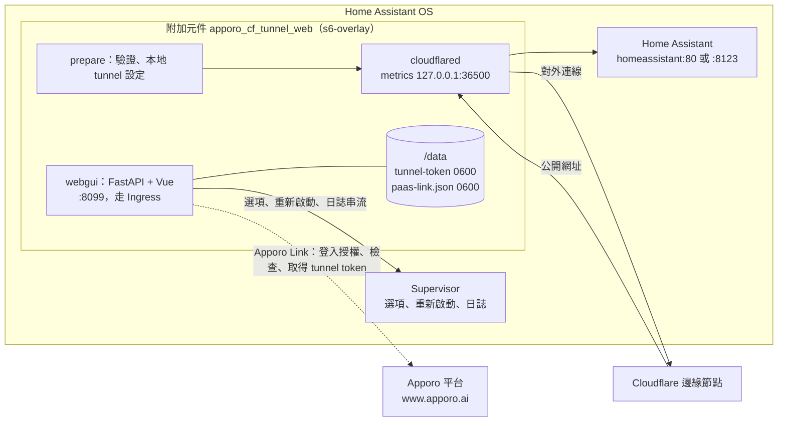

<p align="center">
  
</p>

<h1 align="center">Apporo CF Tunnel Web for Home Assistant</h1>

<p align="center">
  <strong>不用開任何連接埠，就把 Apporo 的 Security Access（Cloudflare Tunnel）接到 Home Assistant，並附網頁介面。</strong>
</p>

<p align="center">
  <a href="README.md">English</a> &bull;
  <a href="#安裝">安裝</a> &bull;
  <a href="#連結-apporo-security-access">連結</a> &bull;
  <a href="#讓-home-assistant-信任隧道">反向代理</a> &bull;
  <a href="#與上游的差異">差異</a> &bull;
  <a href="#開發">開發</a>
</p>

<p align="center">
  
  
  
  
  
</p>

---

## 概述

Apporo CF Tunnel Web 是 [Woow Cloudflared](https://github.com/WOOWTECH/Woow_ha_cloudflare_tunnel_webgui)
（WOOWTECH 附網頁介面的 Cloudflared 附加元件）的 Apporo 版，從它的 1.1.3 版分支而來。上游能做的它都能做，
差別在平台連結連到哪裡：**Apporo Link** 頁面會把 Home Assistant 連到 Apporo 平台
（[www.apporo.ai](https://www.apporo.ai)）上的 **Security Access**（安全存取服務），而不是 WOOW PaaS。

Security Access 是 Apporo 平台的隧道服務：平台會建立 Cloudflare tunnel 與它的公開網址（路由），並可在每條路由
前面加上 Cloudflare Access 登入。這個附加元件在 Home Assistant 裡執行連接器 `cloudflared`，所以路由器上
什麼都不用開。

不用 Apporo 也能照上游的方式使用：貼上任一 Cloudflare tunnel token，或讓附加元件在你自己的 Cloudflare 帳號
建立 tunnel。隧道本體與選項來自 [homeassistant-apps/app-cloudflared][upstream-core]，再加上 WOOW 的安全強化。

- 沒有 Home Assistant OS 的 Linux 主機，請用 Podman 版
  [Apporo CF Tunnel Web](https://github.com/WOOWTECH/apporo_cf_tunnel_web)。
- [Apporo Home Connect](https://github.com/WOOWTECH/apporo_ha_home_connect) 是 Apporo 遠端存取（可加 MCP）的
  Home Assistant 整合，它不執行 Security Access；Security Access 由這個附加元件執行。

### 網頁介面

網頁介面透過 Home Assistant Ingress 提供：按附加元件的「**開啟 Web UI**」，或點側邊欄的 **Apporo Tunnel**。
不開額外的連接埠，由你的 Home Assistant 登入把關。

| 頁面 | 功能 |
|---|---|
| **Dashboard** | 即時隧道狀態（邊緣連線數）、附加元件狀態、重新啟動 |
| **Apporo Link** | 在 www.apporo.ai 以裝置授權碼登入、選擇工作區與 Security Access、逐條檢查路由、連結、測試公開網址、解除連結 |
| **Setup** | 在自己的 Cloudflare 帳號建立 tunnel（本地管理模式）：Cloudflare 授權網址直接顯示成連結，不用去日誌裡找 |
| **Config** | 所有附加元件選項，透過 Supervisor 儲存，所以這一頁和附加元件的「設定」分頁永遠一致 |
| **Logs** | 即時附加元件日誌（與「日誌」分頁相同），可篩選、可下載 |

設定完全空白時，附加元件會讓網頁介面繼續執行、隧道維持停止，第一次設定可以直接在瀏覽器完成。上游
app-cloudflared 在這種情況會直接結束。

## 環境需求

- Home Assistant OS（或其他有 Supervisor 的安裝方式），amd64 或 aarch64。
- 使用 Apporo Link：一個 Apporo 帳號，且是該 Security Access 所在工作區的擁有者或管理員。
- 不用 Apporo：一把 Cloudflare tunnel token，或一個有網域的 Cloudflare 帳號（本地管理模式）。

## 安裝

1. 在 Home Assistant 開啟「**設定 → 應用程式 → 應用程式商店**」（舊版為「設定 → 附加元件 → 附加元件商店」），
   按右上角 **⋮** 選「**管理存放庫**」，加入 `https://github.com/WOOWTECH/apporo_ha_cf_tunnel_web` 後關閉視窗。

   或按這個按鈕：

   [](https://my.home-assistant.io/redirect/supervisor_add_addon_repository/?repository_url=https%3A%2F%2Fgithub.com%2FWOOWTECH%2Fapporo_ha_cf_tunnel_web)

2. 在「Apporo CF Tunnel Web (Apporo)」存放庫底下選 **Apporo CF Tunnel Web**，按「**安裝**」。若沒有出現，
   在 **⋮** 選單按「**檢查更新**」後重新整理頁面。
3. 按「**啟動**」。還沒設定時只有網頁介面在執行，隧道會維持停止，直到你連結為止。
4. 按「**開啟 Web UI**」，或點側邊欄的 **Apporo Tunnel**。

接著連結 Apporo Security Access（見下一節），或在 Setup 頁使用自己的 Cloudflare 帳號。

## 連結 Apporo Security Access

請先在 [www.apporo.ai](https://www.apporo.ai) 建立 Security Access：工作區、方案，以及至少一條路由。
一條路由就是一個公開網址和它要轉到的內部服務網址；Home Assistant 本身要填什麼，見[路由的內部網址](#路由的內部網址)。
方案、試用與付款都在平台上處理，這個附加元件不會扣任何款項。

有兩種連結方式。

### 方式一：Apporo Link 頁面（建議）

1. **登入授權。** 開啟 **Apporo Link**，按 **Get device code** 取得裝置授權碼。開啟頁面提供的裝置授權頁
   （`https://www.apporo.ai/device`），登入你的 Apporo 帳號、輸入授權碼並允許連線。授權碼最長 15 分鐘有效，
   頁面會自動更新。這個頁面不會要求你貼 tunnel token。
2. **選擇 Security Access。** 先選工作區，再選 Security Access 服務。工作區裡還沒有服務時，頁面會提供前往平台
   建立的連結；建立後按 **I've finished on Apporo, reload services**。
3. **檢查路由。** 允許連結之前，頁面會檢查服務與每一條路由：
   - 服務已啟用、訂閱有效，且 tunnel 已建立；
   - 沒有綁定其他裝置，也沒有第二個連接器；
   - 每條路由都有公開網址與內部服務網址；
   - **啟用** Access 的路由需要有 Access 席次的方案、一種登入方式（Email OTP 或 Google），以及指名特定 Email
     或 Email 網域的允許規則；過寬的規則（所有人、IP 範圍、國家、bypass）會被拒絕；
   - **未啟用** Access 的路由（公開路由）不需要席次，但任何知道網址的人都能連到你的服務，所以該服務必須自己
     開啟登入（Home Assistant 本身有登入）。頁面會列出這些路由，並要求你確認後才連結。

   依頁面提示到平台修正（路由在 Security Access 的 **Application**（應用程式）分頁，保護設定在
   **Access**（存取控管）分頁），再按 **Check again** 重新檢查。
4. **連結。** 按 **Connect and enable**。頁面會再檢查一次，接著取得 tunnel 憑證、以
   `Apporo CF Tunnel Web (HA add-on)` 的名稱在平台上綁定這個附加元件，把 token 存進附加元件的
   `tunnel_token` 選項，並重新啟動附加元件。重新啟動期間網頁介面會有幾秒鐘無法使用。若 token 無法儲存，
   會還原先前的選項並解除綁定。

連結後，**Refresh connection status** 會顯示訂閱、每個網址的存取模式與隧道狀態。**Test public URLs** 會對每個
公開網址送出匿名請求，只會顯示網址回應的是 Access 登入頁、公開回應、封鎖或來源錯誤，不代表指定的人能成功
登入。修改路由的保護設定後，平台要等有連接器在線才會發布變更；發布前網址會回 503，頁面會把該路由標示為等待發布。

連結期間，Config 頁的 token 會被鎖定。按 **Stop the local connection and release the binding** 會移除 token
與本機路由選項（`external_hostname`、`additional_hosts`、`catch_all_service`、`nginx_proxy_manager`），並重新
啟動附加元件。等舊的連接器停止後，才會到平台解除綁定：附加元件再次啟動時會自動進行，也可以按
**Check and finish the remote release**。若有想保留的本地管理模式設定，請在解除連結前先記下來。解除連結不會刪除
公開網址、DNS 紀錄、Access 設定或訂閱，這些請到平台處理。

沒有任何連結時，可以在同一頁撤銷帳號授權。

### 方式二：貼上 tunnel token

1. 在 [www.apporo.ai](https://www.apporo.ai) 開啟你的工作區，再開啟該 Security Access。在 **Overview**（總覽）分頁
   找到 **Connect a machine**（連接一台機器）> **Tunnel token**（通道金鑰），顯示或複製 token。請把它當成密碼保管。
2. 貼到以下任一處：
   - 網頁介面的 **Config** 頁：把 token（貼整段 `cloudflared service install …` 指令也可以）貼進 tunnel token
     欄位，再按 **Save & Restart**；
   - Home Assistant 裡附加元件的「**設定**」分頁：填入 `tunnel_token` 選項（若沒看到，開啟「**顯示未使用的設定
     選項**」），儲存後重新啟動附加元件。

使用 token 時，路由由平台提供：請在平台的 Application 分頁管理，本機的網址與路由選項不會使用。設定了手動貼上的
token 時，Apporo Link 頁面會拒絕連結；若要改用 Apporo Link，請先在 Config 頁移除 token。

同一把 token 一次只在一個地方執行。兩個連接器跑同一把 token 時，Cloudflare 可能把訪客送到其中任何一個。
新的連接器上線後，請立刻停掉舊的。

### 路由的內部網址

`cloudflared` 在附加元件裡、Home Assistant 的內部網路上執行，所以路由的內部服務網址要用 `homeassistant`
指稱 Home Assistant：

- Home Assistant：`http://homeassistant:<連接埠>`，連接埠填「**設定 → 系統 → 網路 → HTTP 伺服器**」裡的
  「**伺服器通訊埠**」。較新的安裝通常是 80（Home Assistant 2026.8 起在 Supervisor 下的預設值），
  較舊的安裝則是 8123。
- 其他附加元件：該附加元件「資訊」頁顯示的主機名稱，加上它的連接埠。
- 區域網路上的裝置：它的位址，例如 `http://192.168.1.2:5001`。

502 通常表示位址或連接埠錯誤，或服務沒有在執行。Home Assistant 回 400 表示它還不信任這個代理（見下一節）。

## 讓 Home Assistant 信任隧道

Home Assistant 會拒絕經由它不信任的代理轉來的請求，並回 400 Bad Request。這個附加元件的請求來自 Supervisor
的內部網路，所以請信任這個網段一次：

- 在「**設定 → 系統 → 網路 → HTTP 伺服器**」的「**反向代理**」區塊，開啟「**信任 X-Forwarded-For**」，
  並在「**信任代理伺服器**」加入 `172.30.33.0/24`。儲存並重新啟動 Home Assistant，跳出「確認新 HTTP 伺服器設定」
  時按確認保留。Home Assistant 2026.8 起，這些設定只在這個頁面調整：`configuration.yaml` 裡的 `http:`
  區塊只會匯入一次，之後就被忽略。
- 2026.8 之前的版本沒有這個頁面，請改在 `configuration.yaml` 加入以下內容並重新啟動 Home Assistant：

  ```yaml
  http:
    use_x_forwarded_for: true
    trusted_proxies:
      - 172.30.33.0/24
  ```

`172.30.33.0/24` 是附加元件取得位址的網段，也是上游文件寫的值。非標準的安裝方式（例如 Proxmox）請在請求失敗後
查看 Home Assistant 日誌，找出要信任的位址。

## 使用自己的 Cloudflare 帳號

和上游相同：

- **遠端管理 tunnel：** 在 Cloudflare Zero Trust 後台建立 tunnel，把它的 token 貼到 Config 頁或
  `tunnel_token` 選項。路由在 Cloudflare 後台管理。
- **本地管理 tunnel：** 設定 `external_hostname` 和／或 `additional_hosts` 後啟動附加元件，它會在你的
  Cloudflare 帳號建立 tunnel 與 DNS 紀錄。Setup 頁會顯示 Cloudflare 授權連結。

每個選項的說明見[附加元件文件](cloudflared/DOCS.md)（英文），Home Assistant 也會在附加元件的「相關文件」分頁顯示。

## 與 WOOW 的 Cloudflared 附加元件並存

這個附加元件有自己的 slug（`apporo_cf_tunnel_web`）與映像檔，所以 Home Assistant 把它當成另一個附加元件：
它會裝在 WOOW 的 Cloudflared 附加元件（slug `cloudflared`）旁邊，而不是升級它，並從屬於自己的空白選項與資料
開始，不會沿用 WOOW 附加元件的任何設定。

同一條隧道絕不要在兩邊同時執行。要把目前由 WOOW 附加元件執行的隧道搬過來（例如之前貼到那邊的 Apporo token），
請先在這裡連結；等這裡的 Dashboard 顯示有邊緣連線後，立刻從 WOOW 的附加元件移除那把 token 或停掉它。
若兩邊都在同一個 Cloudflare 帳號使用本地管理 tunnel，請給它們不同的 `tunnel_name` 與網址。

## 與上游的差異

| | 上游 1.1.3（WOOW） | 本分支 1.0.0（Apporo） |
|---|---|---|
| 附加元件名稱／slug | `Woow Cloudflared`／`cloudflared` | `Apporo CF Tunnel Web`／`apporo_cf_tunnel_web` |
| 存放庫 | `WOOWTECH/Woow_ha_cloudflare_tunnel_webgui` | `WOOWTECH/apporo_ha_cf_tunnel_web` |
| 映像檔 | `ghcr.io/woowtech/{arch}-addon-cloudflared-webgui` | `ghcr.io/woowtech/{arch}-addon-apporo-cf-tunnel-web` |
| 側邊欄面板 | `Cloudflared` | `Apporo Tunnel` |
| 平台連結 | WOOW PaaS，`https://aiot.woowtech.io` | Apporo Security Access，`https://www.apporo.ai` |
| 在平台上的裝置名稱 | `Woow Cloudflared add-on` | `Apporo CF Tunnel Web (HA add-on)` |
| OAuth client、scope、API 路徑 | `woow-ha-smart-home`；`workspace:read security-access:read security-access:tunnel` | 不變 |
| 網頁介面 | 繁體中文與英文混合，Cloudflare 橘色 `#F6821F`；平台頁面「PaaS 連結」 | 英文，Apporo 金色 `#8B6B24`；平台頁面「Apporo Link」 |
| 發布方式 | WOOW App Store 流程（升版比對、GitHub Release） | `main` 上調升版本號即發布映像檔 |
| 版本 | 1.1.3 | 1.0.0（版本號重新起算） |

不變的部分：隧道本體與它的本地／遠端管理模式、選項 schema、Ingress 連接埠 8099、`hassio_role: manager`、
私有 token 檔、只監聽 `127.0.0.1:36500` 的 metrics、憑證檔防護，以及日誌遮罩。完整清單見
[變更紀錄](cloudflared/CHANGELOG.md)。

## 架構



Supervisor 選項是唯一的事實來源：Config 頁與 Apporo Link 都透過 Supervisor API 寫入選項並重新啟動附加元件，
附加元件再以私有檔案中的 token（`--token-file`）或本地 tunnel 產生的設定啟動 `cloudflared`。

## 安全性

- **網頁介面只能經由 Ingress 連線。** 不是來自 Supervisor Ingress 代理的請求一律拒絕，所以由你的
  Home Assistant 登入把關。
- **Apporo 的登入授權只留在後端。** Apporo Link 的 OAuth token 存在 `/data/paas-link.json`（權限 0600）。
  只有後端會處理它們與 tunnel 憑證，瀏覽器只拿到導覽網址與不含祕密的摘要。平台來源網址固定寫在映像檔裡
  （`https://www.apporo.ai`），平台回傳的裝置授權頁若不在該網域的 `/device`，登入會被拒絕。
- **tunnel token 不會出現在命令列。** 它存在 `tunnel_token` 選項（Home Assistant 會遮蔽顯示），`cloudflared`
  以 `--token-file` 從 `/data/tunnel-token`（權限 0600）讀取。網頁介面只顯示遮蔽後的值，日誌也會遮罩。
- metrics 只在附加元件內監聽 `127.0.0.1:36500`。
- **備份裡有祕密。** 這個附加元件的備份含有 tunnel token；用過 Apporo Link 之後，也含有平台的 OAuth
  refresh token。請妥善保管備份。

## 開發

```bash
# 後端與附加元件測試（Python 3.12 以上；CI 與映像檔使用 3.14）
python3 -m venv .venv
.venv/bin/pip install -r cloudflared/webgui/requirements-dev.txt PyYAML
(cd cloudflared/webgui && ../../.venv/bin/python -m pytest -q)
.venv/bin/python -m pytest -q cloudflared/tests
.venv/bin/python cloudflared/tests/ha05_api_error_probe.py cloudflared/webgui
bash cloudflared/tests/test_token_safety.sh
bash cloudflared/tests/test_resilience_patches.sh

# 前端（Node 22）
cd cloudflared/webgui/frontend
npm ci
npm test         # vitest
npm run build    # 型別檢查並建置到 dist/
npm run dev      # 開發伺服器，會把 /api 代理到 :8099

# 在 Home Assistant 之外，以後端提供建置好的前端
cd cloudflared/webgui
WEBGUI_DEV=1 WEBGUI_STATIC=$PWD/frontend/dist \
  ../../.venv/bin/python -m uvicorn backend.main:app --port 8099
```

Build 工作流程（`.github/workflows/build.yaml`）會跑同樣的測試與前端建置，再以
[home-assistant/builder](https://github.com/home-assistant/builder) 建置 amd64 與 aarch64 的附加元件，
並對 amd64 映像檔做冒煙測試。Pull request 只建置不推送。在 `main` 上，它會依 `cloudflared/config.yaml`
的版本發布 `ghcr.io/woowtech/{arch}-addon-apporo-cf-tunnel-web:<version>`（以及 `latest`），除非該版本已經
發布過：已發布的版本絕不覆蓋，所以只有調升版本號才會送到使用者手上。修改規則見 [AGENTS.md](AGENTS.md)。

### 合併上游

```bash
git remote add woow https://github.com/WOOWTECH/Woow_ha_cloudflare_tunnel_webgui.git
git fetch woow
git merge woow/main
```

衝突會出現在本分支改過的檔案：品牌、平台連結、附加元件中繼資料與翻譯、CI 與文件。請保留 Apporo 這一邊；
平台契約（OAuth client id、scope、API 路徑）在兩個平台上相同。

## 支援

- 問題回報：[GitHub Issues](https://github.com/WOOWTECH/apporo_ha_cf_tunnel_web/issues)
- 上游專案：[WOOWTECH/Woow_ha_cloudflare_tunnel_webgui](https://github.com/WOOWTECH/Woow_ha_cloudflare_tunnel_webgui)
- 變更紀錄：[cloudflared/CHANGELOG.md](cloudflared/CHANGELOG.md)

## 致謝與授權

MIT，見 [LICENSE.md](LICENSE.md)。Copyright (c) 2026 Unofficial Home Assistant Apps (Add-ons)（上游）與
(c) 2026 Apporo（分支修改）。

隧道本體來自 [homeassistant-apps/app-cloudflared][upstream-core]（原作者 [Tobias Brenner][brenner-tobias]）；
網頁介面與平台引導連結由 [WOOWTECH](https://github.com/WOOWTECH) 開發，出自
[Woow_ha_cloudflare_tunnel_webgui][woow-addon]。Apporo CF Tunnel Web 把它們接到 Apporo 平台。

[upstream-core]: https://github.com/homeassistant-apps/app-cloudflared
[brenner-tobias]: https://github.com/brenner-tobias
[woow-addon]: https://github.com/WOOWTECH/Woow_ha_cloudflare_tunnel_webgui
